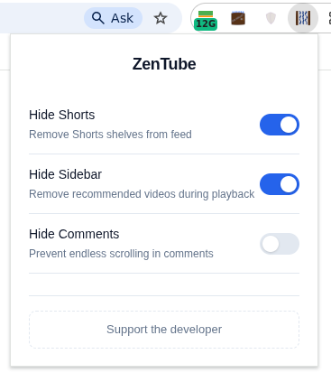

# ZenTube

A simple, private, and efficient browser extension for Google Chrome and Chromium-based browsers. Remove distractions like Shorts, sidebars, and comments to maintain control over your attention and break the infinite scrolling cycle.

 

---
## Screenshots

  

---

## Features

- **Hide Shorts**: Removes Shorts shelves from the homepage and search results.
- **Hide Sidebar**: Removes the recommended videos column during playback, automatically expanding the main video player to full width.
- **Hide Comments**: Optionally hides the comments section to prevent endless scrolling and distraction.
- **Real-time Toggling**: Changes apply instantly without requiring a page reload.
- **100% Local & Private**: Your settings are saved exclusively in `chrome.storage.local`. No data is ever sent to external servers.

---

## Privacy & Permissions

Zentube is built with a "Privacy-First" philosophy. It requests only the absolute minimum permissions required to function:

- **`storage`**: To save and load your UI preferences locally on your device.
- **`content_scripts`**: To apply user-defined CSS hiding rules natively within the browser on youtube.com. **We do not read, track, or store your browsing history, URLs, or tab content.**

Read the full, detailed policy here: **[POLICY](docs/POLICY)**

---

## License

This project is open-source and licensed under the **[MIT License](docs/LICENSE)**.

---

## Support the Project

If you find Zentube useful, consider supporting its development! Your contribution helps keep the project alive and ad-free.

